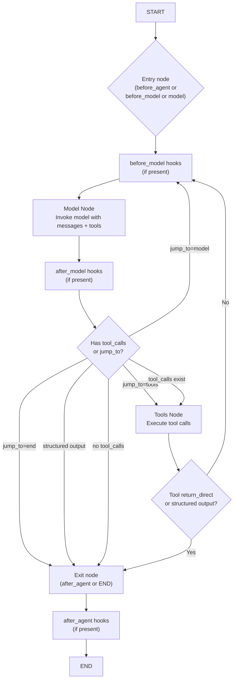

# Agent Execution: From Request to Response

Agent execution in LangChain follows a structured loop orchestrated by the [`create_agent`][langchain.agents.create_agent] factory. The agent model repeatedly plan, invoke tools, and interpret results until a termination condition is met. This document covers the end-to-end control flow, state management, middleware composition, and error handling patterns that make this agentic loop reliable and extensible.

## Conceptual Overview

Agent execution flows through three core responsibilities:

1. **Model Invocation**: Call the language model with current messages + system prompt + bound tools, producing an `AIMessage` with optional `tool_calls`.
2. **Tool Execution**: Execute each tool call via a `ToolNode`, returning `ToolMessage` results that feed back into the conversation.
3. **Routing & Termination**: Decide whether to loop back to the model, skip tools, or terminate based on tool calls, routing hints, and structured output state.

Middleware intercepts execution at every stage—before/after model calls, before/after tool execution, and at agent lifecycle boundaries—to customize behavior without modifying core logic.

## Agent State and Lifecycle

Every agent operates over an `AgentState` that persists the conversation and provides optional fields for routing and structured outputs:

```python
class AgentState(TypedDict, Generic[ResponseT]):
    """State schema for the agent."""
    messages: Required[Annotated[list[AnyMessage], add_messages]]
    jump_to: NotRequired[Annotated[JumpTo | None, EphemeralValue]]
    structured_response: NotRequired[Annotated[ResponseT, OmitFromOutput]]
```

**Field roles:**

- **`messages`**: Conversation history merged via `add_messages` reducer (new messages append). Can be injected at any time for tool result handling or synthetic message injection.
- **`jump_to`**: Ephemeral routing hint set by middleware hooks to direct flow ("tools", "model", or "end"). Cleared after each use.
- **`structured_response`**: Parsed output when `response_format` is configured; otherwise `None`. Optional in output schema, allowing agents to function with or without structured output.

Middleware can extend `AgentState` with custom fields via `state_schema` parameter, enabling domain-specific state tracking (user context, cost tracking, decision history, etc.).

## Agent Loop Architecture

The agent loop consists of phases executed in sequence:

1. **before_agent hooks** (once at start): Setup, state injection, validation.
2. **Looping iteration**:
   - **before_model hooks**: Message filtering, tool narrowing, constraints.
   - **Model Node**: Call model with messages + tools, get `AIMessage`.
   - **after_model hooks**: Logging, validation, routing overrides.
   - **Routing decision**: Check tool calls, `jump_to`, structured output.
   - **Tools Node** (if routed): Execute tools, get `ToolMessage` results.
3. **after_agent hooks** (once at end): Cleanup, logging, final state updates.

The routing logic determines the next node:

- If `AIMessage` has `tool_calls`: Route to tools node (execute).
- If `state["jump_to"] == "model"`: Loop back to before_model.
- If `state["jump_to"] == "end"`: Skip to termination.
- If no tool calls and no structured output: Route to termination (classic exit).
- If structured output was produced: Route to termination immediately.

## Middleware Composition and Ordering

Middleware applies in **first-in, outermost** order. The first middleware in the list wraps all others for request flow; responses travel back outward:

```python
middleware = [CacheMiddleware(), RetryMiddleware(), LoggingMiddleware()]
agent = create_agent(model="openai:gpt-4o", tools=[...], middleware=middleware)

# Model call flow:
# CacheMiddleware.wrap_model_call()
#   -> RetryMiddleware.wrap_model_call()
#     -> LoggingMiddleware.wrap_model_call()
#       -> actual model execution

# Response bubbles back:
# LoggingMiddleware sees response
#   -> RetryMiddleware sees response
#     -> CacheMiddleware sees response
```

### Middleware State Schema Composition

Middleware state schemas merge in order (first to last), with the agent's explicit `state_schema` parameter always winning conflicts:

```python
class M1Middleware(AgentMiddleware):
    state_schema = TypedDict("M1State", {"cost": Required[float]})

class M2Middleware(AgentMiddleware):
    state_schema = TypedDict("M2State", {"cost": Optional[float], "tokens": Required[int]})

agent = create_agent(
    model=...,
    middleware=[M1Middleware(), M2Middleware()],
    state_schema=MyCustomState,  # Wins on conflicts
)
```

Final state schema: `M1Middleware.state_schema` + `M2Middleware.state_schema` + `MyCustomState` (last wins).

## Creating an Agent

### Minimal Example

```python
from langchain.agents import create_agent
from langchain_core.tools import tool

@tool
def search(query: str) -> str:
    """Search for information."""
    return f"Results for {query}"

agent = create_agent(
    model="openai:gpt-4o",
    tools=[search],
    system_prompt="You are a helpful assistant"
)

# Run the agent
result = agent.invoke({"messages": [{"role": "user", "content": "Search for AI news"}]})
print(result["messages"][-1].content)
```

### Factory Signature

```python
def create_agent(
    model: str | BaseChatModel,
    tools: Sequence[BaseTool | Callable[..., Any] | dict[str, Any]] | None = None,
    *,
    system_prompt: str | SystemMessage | None = None,
    middleware: Sequence[AgentMiddleware[StateT_co, ContextT]] = (),
    response_format: ResponseFormat[ResponseT] | type[ResponseT] | None = None,
    state_schema: type[AgentState[ResponseT]] | None = None,
    context_schema: type[ContextT] | None = None,
    checkpointer: Checkpointer | None = None,
    store: BaseStore | None = None,
    interrupt_before: list[str] | None = None,
    interrupt_after: list[str] | None = None,
    debug: bool = False,
    name: str | None = None,
    cache: BaseCache[Any] | None = None,
    transformers: Sequence[TransformerFactory] | None = None,
) -> CompiledStateGraph[AgentState[ResponseT], ContextT, InputAgentState, OutputAgentState[ResponseT]]
```

### Key Parameters

| Parameter | Purpose | Notes |
|-----------|---------|-------|
| `model` | Language model | String (e.g., `"openai:gpt-4o"`) or `BaseChatModel` instance; initialized via `init_chat_model()` |
| `tools` | Tool functions/schemas | `BaseTool`, callables, or dict schemas; can be empty (model-only agent) |
| `system_prompt` | Model instructions | String or `SystemMessage`; prepended to every model call |
| `middleware` | Pre/post hooks and wrappers | Ordered list; first = outermost layer |
| `response_format` | Structured output schema | `ToolStrategy`, `ProviderStrategy`, `AutoStrategy`, or Pydantic class |
| `state_schema` | Custom state fields | Extends `AgentState` with application fields |
| `checkpointer` | Conversation memory | Saves state per thread; enables resumption |
| `store` | Cross-thread persistence | Retrieve context across conversations |
| `interrupt_before/after` | Human-in-the-loop | Pause before/after named nodes |
| `debug` | Verbose logging | Prints execution trace |
| `transformers` | Stream output formatters | Custom `StreamTransformer` factories |

## Tool Binding and Execution

### Tool Types

Tools can be provided in three formats:

**1. BaseTool instances (preferred):**
```python
from langchain_core.tools import tool

@tool
def search(query: str) -> str:
    """Search for information."""
    return f"Results for {query}"

agent = create_agent(model="openai:gpt-4o", tools=[search])
```

**2. Python callables (auto-wrapped):**
```python
def search(query: str) -> str:
    """Search for information."""
    return f"Results for {query}"

agent = create_agent(model="openai:gpt-4o", tools=[search])
```

**3. Dict schemas (provider built-ins):**
```python
tools = [
    {
        "type": "builtin_text_search",  # Provider-specific identifier
        "name": "search",
        "description": "Search for information"
    }
]
agent = create_agent(model="anthropic:claude-opus", tools=tools)
```

### Tool Node and Execution Flow

When tools are provided, `create_agent` constructs a `ToolNode` that:

1. Receives the model's `AIMessage` with `tool_calls`.
2. Validates that all tool names are registered.
3. Executes each tool call (sync or async).
4. Wraps results in `ToolMessage` objects.
5. Applies middleware `wrap_tool_call` wrappers.
6. Catches exceptions and returns error `ToolMessage` objects.

The `ToolNode` is the exclusive point of tool execution in the default flow. Middleware wrappers can intercept calls via `wrap_tool_call(request, handler)`.

### Model Binding and Tool Binding

Before model invocation, `create_agent` binds tools using `model.bind_tools()`:

```python
bound_model = model.bind_tools(
    final_tools,
    tool_choice=tool_choice,  # "any", "required", specific name, or None
    **model_settings
)
```

Tool binding is provider-specific; each model implementation handles tool descriptions and schema serialization.

### Structured Output Handling

When `response_format` is configured, `create_agent` selects a strategy:

- **ProviderStrategy**: Uses the model's native structured output API (e.g., OpenAI's `response_format` with JSON schema).
- **ToolStrategy**: Creates pseudo-tools for each schema; model calls the tool to return structured data, which is parsed and stored in `state["structured_response"]`.
- **AutoStrategy**: Auto-detects the best strategy based on model capabilities; converted to `ProviderStrategy` or `ToolStrategy` at runtime.

When `ToolStrategy` is active:
1. Structured output tools are added to the model's tool list.
2. If the model calls a structured output tool, the tool call is executed to parse the schema.
3. The parsed result is stored in `state["structured_response"]`.
4. Agent routes to termination immediately (does not loop back for more tools).

## Middleware: Hooks and Wrappers

Middleware instances inherit from `AgentMiddleware` and implement any combination of node hooks or handler wrappers.

### Node Hooks (before_agent, after_agent, before_model, after_model)

Node hooks are called once per node execution and can return state updates:

```python
from langchain.agents import AgentMiddleware, AgentState
from langgraph.runtime import Runtime

class MyMiddleware(AgentMiddleware):
    def before_agent(self, state: AgentState, runtime: Runtime) -> dict[str, Any] | None:
        """Called once before agent execution starts."""
        return {"custom_field": "value"}  # Injected into state
    
    def before_model(self, state: AgentState, runtime: Runtime) -> dict[str, Any] | None:
        """Called before each model invocation (runs in loop)."""
        return None  # No state updates
    
    def after_model(self, state: AgentState, runtime: Runtime) -> dict[str, Any] | None:
        """Called after each model invocation (runs in loop)."""
        return None
    
    def after_agent(self, state: AgentState, runtime: Runtime) -> dict[str, Any] | None:
        """Called once after agent execution completes."""
        return None
```

**Routing via jump_to:**

Node hooks can set `state["jump_to"]` to override routing:
- `"model"`: Loop back to model node (skip tools).
- `"tools"`: Jump to tools node (execute tools).
- `"end"`: Skip to termination.

### Handler Wrappers (wrap_model_call, wrap_tool_call)

Wrappers intercept core operations by wrapping handler callbacks:

#### wrap_model_call

Intercepts model execution, allowing retry, caching, fallback, and response modification:

```python
from langchain.agents import AgentMiddleware, ModelRequest, ModelResponse, ExtendedModelResponse
from langchain_core.messages import AIMessage

class RetryMiddleware(AgentMiddleware):
    def wrap_model_call(self, request: ModelRequest, handler):
        """Retry model call up to 3 times on error."""
        for attempt in range(3):
            try:
                return handler(request)  # Execute the model
            except Exception as e:
                if attempt == 2:
                    raise
                print(f"Attempt {attempt + 1} failed: {e}")
```

**Request modification:**

```python
class ToolFilterMiddleware(AgentMiddleware):
    def wrap_model_call(self, request: ModelRequest, handler):
        # Filter tools based on user context
        user_level = request.state.get("user_level", "basic")
        allowed_tools = [t for t in request.tools if t.name not in ["admin_tool"]]
        new_request = request.override(tools=allowed_tools)
        return handler(new_request)
```

**Return types:**

- `ModelResponse`: Standard response with `result` (messages) and optional `structured_response`.
- `AIMessage`: Simplified response; auto-converted to `ModelResponse`.
- `ExtendedModelResponse`: Response + optional `Command` for additional state updates (messages, fields).

#### wrap_tool_call

Intercepts tool execution, allowing validation, retry, monitoring, and mocking:

```python
from langchain.agents import AgentMiddleware

class ToolValidationMiddleware(AgentMiddleware):
    def wrap_tool_call(self, request, handler):
        """Validate tool call arguments before execution."""
        # request.tool_call is a dict with name, id, args
        args = request.tool_call.get("args", {})
        if not args.get("required_field"):
            # Reject invalid call; model will retry
            from langchain_core.messages import ToolMessage
            return ToolMessage(
                content="Missing required_field",
                tool_call_id=request.tool_call["id"],
                name=request.tool_call["name"],
                status="error"
            )
        return handler(request)
```

**Return types:**

- `ToolMessage`: Tool execution result.
- `Command`: Route to a different node or update state.

## Agent Execution Flow

### Synchronous vs. Asynchronous

`create_agent` returns a compiled graph supporting both sync and async:

```python
# Synchronous
result = agent.invoke({"messages": [...]})

# Asynchronous
result = await agent.ainvoke({"messages": [...]})

# Streaming (sync)
for chunk in agent.stream({"messages": [...]}, stream_mode="updates"):
    print(chunk)

# Streaming (async)
async for chunk in agent.astream({"messages": [...]}):
    print(chunk)
```

The graph automatically selects sync or async based on the execution context. If middleware implements only async (`awrap_model_call`) and is invoked synchronously, it raises `NotImplementedError`. Provide both implementations for maximum compatibility.

### Control Flow Diagram



This diagram shows the main execution path, with conditional branching based on tool calls, routing hints, and termination conditions.

### Detailed Execution Steps

**1. Initialization (before_agent):**
   - Middleware `before_agent` hooks run once, allowing setup and state injection.
   - State updates are merged using reducers (e.g., `add_messages` for messages).
   - Entry point proceeds to next phase or loops start (before_model or model).

**2. Model Loop Iteration:**
   - **before_model**: Hooks run (multiple times in loop), allowing message filtering, tool narrowing, constraints.
   - **model**: Model is called with current messages + system prompt + bound tools. Returns `AIMessage` with optional `tool_calls`.
   - **after_model**: Hooks run for logging, validation, or routing overrides via `jump_to`.

**3. Routing Decision:**
   - If `state["jump_to"] == "model"`: Loop back to before_model.
   - If `state["jump_to"] == "end"`: Skip to termination.
   - If `AIMessage` has `tool_calls`: Route to tools node.
   - If structured output was produced: Route to termination.
   - If no tool calls: Route to termination (classic exit).

**4. Tool Execution (if routed):**
   - Each tool call is matched to a registered tool.
   - `wrap_tool_call` middleware intercepts execution (retry, validation, monitoring).
   - Tool result is wrapped in a `ToolMessage`.
   - Routing decision: If any tool has `return_direct=True` or structured output produced: terminate.
   - Otherwise: Loop back to before_model.

**5. Termination (after_agent):**
   - Middleware `after_agent` hooks run once for cleanup, logging, or final state updates.
   - Graph returns final state (messages + optional structured response).
   - Execution ends.

## Error Handling and Resilience

### Invalid Tool Calls

When a model generates a tool call with malformed arguments or unknown tool name, the agent automatically repairs the message history:

1. Invalid calls are detected (JSON parse errors, missing required fields, unknown names).
2. Error `ToolMessage` objects are inserted into the message history.
3. The model is re-invoked to correct the errors.

Middleware can intercept these repairs via `wrap_model_call` or `after_model` hooks.

### Middleware-Induced Tool Mismatches

If middleware adds tools via `wrap_model_call` but doesn't handle their execution, the agent raises an error:

```
ValueError: Middleware added tools that the agent doesn't know how to execute.

Unknown tools: [dynamic_tool]
Registered tools: [search, calculate]

This happens when middleware modifies `request.tools` in `wrap_model_call` to include
tools that weren't passed to `create_agent()`.
```

**Solutions:**

1. **Register tools upfront** (recommended): Pass tools to `create_agent(tools=[...])` or set them on middleware.
2. **Handle dynamic tools**: Implement `wrap_tool_call` in the middleware to execute tools added at runtime.
3. **Use provider tools**: If the provider supports dict-based tools, use those instead.

### Async-Sync Context Mismatch

If middleware implements only async (`awrap_model_call`) and the agent is invoked synchronously:

```
NotImplementedError: Asynchronous implementation of awrap_model_call is not available.
```

**Solutions:**

1. Implement both `wrap_model_call` and `awrap_model_call`.
2. Invoke the agent asynchronously: `agent.ainvoke()` or `agent.astream()`.

## Common Middleware Patterns

### Pattern 1: Tool Selection and Routing

Narrow the tools available to the model based on context:

```python
from langchain.agents import AgentMiddleware, ModelRequest

class ContextualToolSelector(AgentMiddleware):
    def wrap_model_call(self, request: ModelRequest, handler):
        # Filter tools dynamically based on user context
        user_level = request.state.get("user_level", "basic")
        filtered_tools = [t for t in request.tools if user_level != "basic" or "admin" not in t.name]
        new_request = request.override(tools=filtered_tools)
        return handler(new_request)
```

### Pattern 2: Retry and Error Recovery

Implement exponential backoff or fallback strategies:

```python
import asyncio
from langchain.agents import AgentMiddleware, ModelRequest, ModelResponse
from langchain_core.messages import AIMessage

class SmartRetryMiddleware(AgentMiddleware):
    async def awrap_model_call(self, request: ModelRequest, handler):
        backoff = 1
        for attempt in range(3):
            try:
                return await handler(request)
            except Exception as e:
                if attempt < 2:
                    await asyncio.sleep(backoff)
                    backoff *= 2
                else:
                    # Fallback: return safe response
                    return ModelResponse(
                        result=[AIMessage(content="I encountered an error. Please try again.")]
                    )
```

### Pattern 3: Output Formatting and Validation

Post-process model responses to ensure compliance:

```python
from langchain.agents import AgentMiddleware, ModelResponse
from langchain_core.messages import AIMessage

class OutputFormatterMiddleware(AgentMiddleware):
    def wrap_model_call(self, request, handler):
        response = handler(request)
        # Ensure response is ModelResponse
        if isinstance(response, AIMessage):
            response = ModelResponse(result=[response])
        
        # Post-process AI message
        ai_msg = response.result[0]
        formatted_content = f"Response: {ai_msg.content}"
        return ModelResponse(
            result=[AIMessage(content=formatted_content, tool_calls=ai_msg.tool_calls)],
            structured_response=response.structured_response
        )
```

### Pattern 4: Human-in-the-Loop

Implement user approval before tools are executed:

```python
from langchain.agents import AgentMiddleware

class HumanApprovalMiddleware(AgentMiddleware):
    def wrap_tool_call(self, request, handler):
        # Optionally: ask user for approval
        user_input = input(f"Execute {request.tool_call['name']}? (y/n): ")
        if user_input.lower() != "y":
            from langchain_core.messages import ToolMessage
            return ToolMessage(
                content="User declined tool execution",
                tool_call_id=request.tool_call["id"],
                name=request.tool_call["name"],
                status="error"
            )
        return handler(request)
```

## Performance and Scaling

### Checkpointing for Resumption

Store agent state per conversation thread for resumption:

```python
from langgraph.checkpoint.memory import MemorySaver

agent = create_agent(
    model="openai:gpt-4o",
    tools=[...],
    checkpointer=MemorySaver()
)

# First invocation
thread = {"configurable": {"thread_id": "user_123"}}
result = agent.invoke({"messages": [...]}, thread)

# Resume later
result2 = agent.invoke({"messages": [...]}, thread)  # Resumes from saved state
```

### Cross-Thread Persistence

Store data accessible across multiple conversations:

```python
from langgraph.store.memory import InMemoryStore

agent = create_agent(
    model="openai:gpt-4o",
    tools=[...],
    store=InMemoryStore()
)

# Middleware can query the store
class ContextMiddleware(AgentMiddleware):
    def before_model(self, state, runtime):
        # Load user context from store
        user_id = state.get("user_id")
        if user_id and runtime.store:
            context = runtime.store.get("user_context", user_id)
            # Use context to shape model behavior
        return None
```

### Caching and Streaming

Enable graph-level caching and configure stream transformers:

```python
from langgraph.cache.base import BaseCache

agent = create_agent(
    model="openai:gpt-4o",
    tools=[...],
    cache=my_cache,  # Cache entire graph outputs
    transformers=[my_transformer]  # Custom stream formatters
)

# Stream with updates
for chunk in agent.stream(
    {"messages": [...]},
    stream_mode="updates",
    config={"recursion_limit": 100}
):
    print(chunk)
```

## Testing and Debugging

### Debug Mode

Enable verbose logging to trace execution:

```python
agent = create_agent(
    model="openai:gpt-4o",
    tools=[...],
    debug=True
)

result = agent.invoke({"messages": [...]})
# Prints node transitions, state updates, and execution trace
```

### Mocking Tools for Unit Tests

```python
from langchain_core.tools import tool

@tool
def mock_search(query: str) -> str:
    """Mock search tool."""
    if "AI" in query:
        return "Artificial Intelligence is..."
    return "No results"

agent = create_agent(
    model="openai:gpt-4o",
    tools=[mock_search]
)

# Test agent
result = agent.invoke({"messages": [{"role": "user", "content": "Tell me about AI"}]})
assert "Artificial Intelligence" in result["messages"][-1].content
```

### Testing Middleware

```python
from langchain.agents import ModelRequest, ModelResponse
from langchain_core.messages import AIMessage

def test_retry_middleware():
    middleware = SmartRetryMiddleware()
    request = ModelRequest(model=model, messages=[], tools=[])
    
    call_count = 0
    def failing_handler(req):
        nonlocal call_count
        call_count += 1
        if call_count < 2:
            raise ValueError("Transient error")
        return ModelResponse(result=[AIMessage(content="Success")])
    
    result = middleware.wrap_model_call(request, failing_handler)
    assert call_count == 2  # Retried once
    assert "Success" in result.result[0].content
```

## Practical Example: Multi-Tool Planner Agent

```python
from langchain.agents import create_agent, AgentMiddleware, ModelRequest
from langchain_core.tools import tool
from langchain_core.messages import HumanMessage
from langchain_openai import ChatOpenAI

# Define tools
@tool
def search(query: str) -> str:
    """Search the web."""
    return f"Results for: {query}"

@tool
def calculate(expr: str) -> str:
    """Evaluate a math expression."""
    return str(eval(expr))

# Middleware for planning
class PlannerMiddleware(AgentMiddleware):
    def before_agent(self, state, runtime):
        # Inject a planning step at the start
        plan_request = HumanMessage(
            content="First, make a plan for how to solve this problem. Then execute it."
        )
        return {"messages": [plan_request]}

# Create agent
agent = create_agent(
    model=ChatOpenAI(model="gpt-4o"),
    tools=[search, calculate],
    system_prompt="You are a helpful assistant with access to search and math tools.",
    middleware=[PlannerMiddleware()],
    debug=True
)

# Run
result = agent.invoke({
    "messages": [{"role": "user", "content": "What is the population of France times 2?"}]
})

print(result["messages"][-1].content)
```

## Related Concepts

- **Chat Models**: Language models that accept messages and return responses (see `/openwiki/concepts/chat-models.md`)
- **Tools**: Schema-driven functions that agents can invoke (see `/openwiki/concepts/tools.md`)
- **Runnables**: The invokable interface for composable workflows (see `/openwiki/concepts/runnables.md`)
- **Middleware Framework**: Base classes and decorators for custom extensions (see `/openwiki/workflows/middleware.md`)
- **Structured Output**: Schema-driven response parsing (see `/openwiki/workflows/structured-output.md`)
